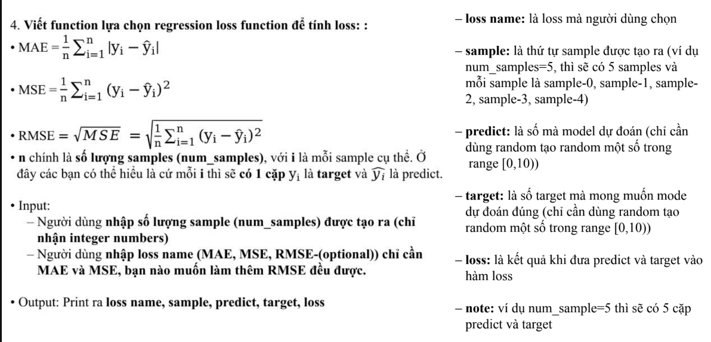
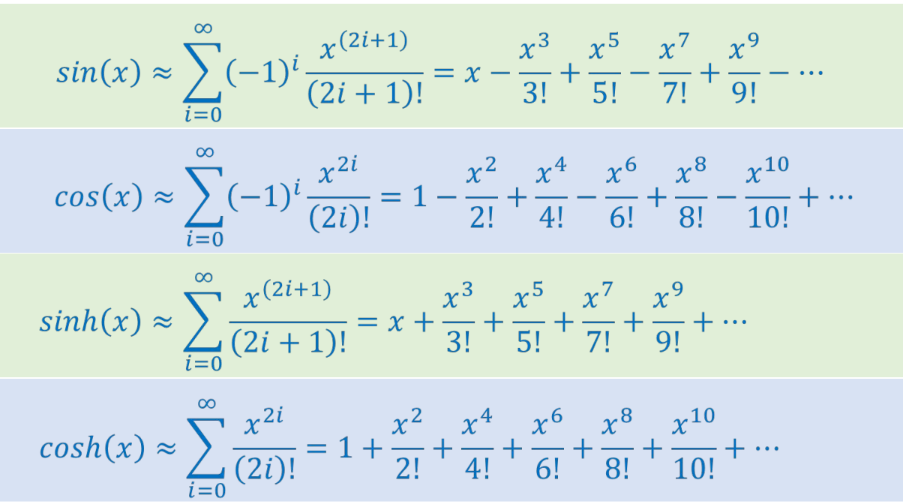

# Exercise Tuần 1
## Logic khi làm mỗi bài tập
1. Hiểu đề bài
2. Xác định input và output
3. Điều kiện ràng buộc
- Ta phải nghĩ ra mọi trường hợp cho điều kiện ràng buộc
VD: Khi làm một trang web bán điện thoại. Ta set là Iphone, Samsung,... Nhưng người dùng lại nhập tên viết tắt là ip 17 pro max, ss galaxy,...
-> Không giống theo mong muốn của mình -> Phải catch lỗi.
4. Pseudocode 
- Viết ra logic của mình xem đã khớp với yêu cầu đề bài hay chưa
-> Nó giống như một bản phác thảo logic cho project của mình. Nếu sai -> sửa lại bản phác thảo. Như vậy sẽ hạn chế lỗi hơn.
Có 2 dạng lỗi:
- Lỗi syntax:  Chương trình có thể bắt lỗi cho mình ngay
- Lỗi logic: Chương trình vẫn có thể run được nhưng sẽ có những lỗi ngầm phát sinh khó có thể phát hiện được
-> Pseudocode rất cần thiết
5. Flowchat (Đối với những dự án lớn): Phác thảo luồng hoạt động, vẽ những graph biểu thị luồng hoạt động của sản phẩm, chức năng. Nếu đúng: Chạy theo nhánh nào?. Nếu sai: Chạy nhánh nào?
Đối với những dự án lớn dùng Pseudocode có thể rất rối. Khi mô hình hóa bằng flowchat chúng ta sẽ dễ hình dung và đối chiếu hơn
## Viết Function đánh giá classification model bằng f1-score

## Tính kết quả theo các activation function

## Viết function chọn regression loss function để tính loss
Trong quá trình trainng, loss biểu thị việc sai số dự đoán của model so với giá trị thực, càng train - loss càng giảm -> đi đúng hướng. Nếu loss tăng -> model đang sai
3 Hàm loss phổ biến:
    +) MAE (Mean Absolute Error)
    +) MSE (Mean Squared Error)
    +) RMSE(Root Mean Square Error)

## Viết các function để ước lượng các hàm số

Không cho chạy đến vô cùng. Chỉ chạy đến n
