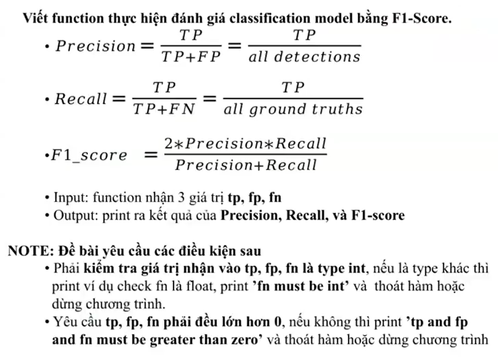
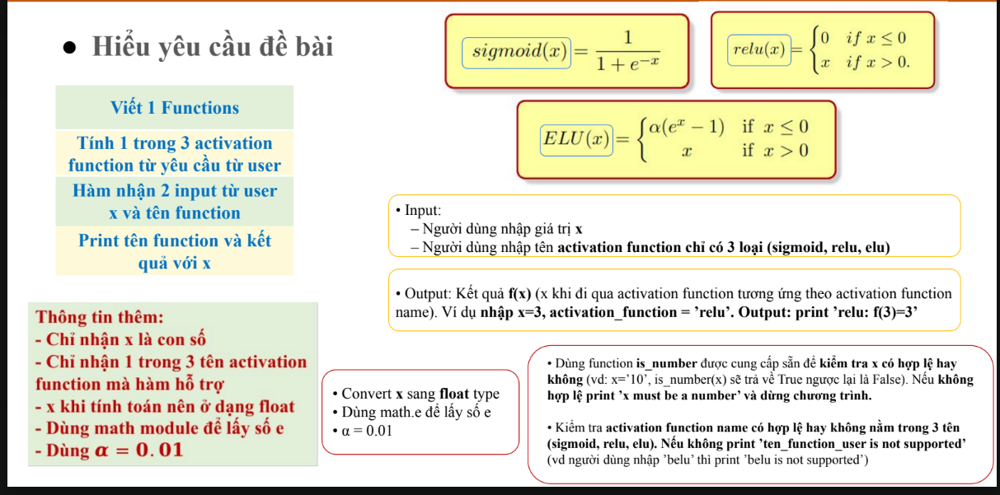
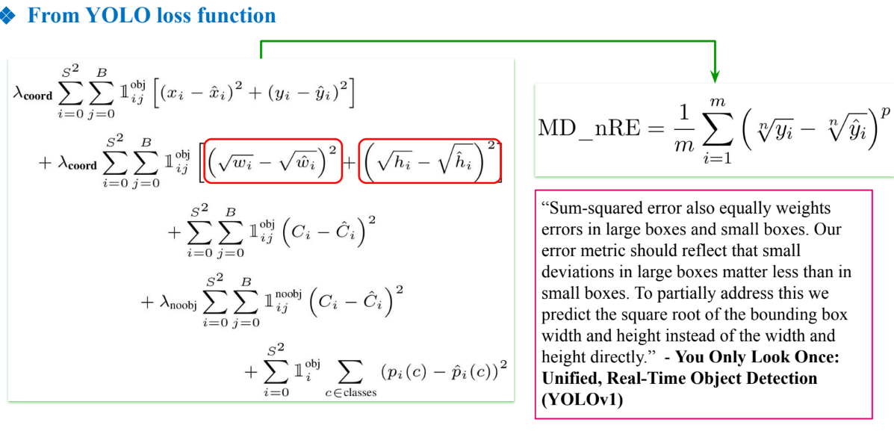

# Exercise Tuần 1
## Logic khi làm mỗi bài tập
1. Hiểu đề bài
2. Xác định input và output
3. Điều kiện ràng buộc
- Ta phải nghĩ ra mọi trường hợp cho điều kiện ràng buộc
VD: Khi làm một trang web bán điện thoại. Ta set là Iphone, Samsung,... Nhưng người dùng lại nhập tên viết tắt là ip 17 pro max, ss galaxy,...
-> Không giống theo mong muốn của mình -> Phải catch lỗi.
4. Pseudocode 
- Viết ra logic của mình xem đã khớp với yêu cầu đề bài hay chưa
-> Nó giống như một bản phác thảo logic cho project của mình. Nếu sai -> sửa lại bản phác thảo. Như vậy sẽ hạn chế lỗi hơn.
Có 2 dạng lỗi:
- Lỗi syntax:  Chương trình có thể bắt lỗi cho mình ngay
- Lỗi logic: Chương trình vẫn có thể run được nhưng sẽ có những lỗi ngầm phát sinh khó có thể phát hiện được
-> Pseudocode rất cần thiết
5. Flowchat (Đối với những dự án lớn): Phác thảo luồng hoạt động, vẽ những graph biểu thị luồng hoạt động của sản phẩm, chức năng. Nếu đúng: Chạy theo nhánh nào?. Nếu sai: Chạy nhánh nào?
Đối với những dự án lớn dùng Pseudocode có thể rất rối. Khi mô hình hóa bằng flowchat chúng ta sẽ dễ hình dung và đối chiếu hơn
## Viết Function đánh giá classification model bằng f1-score

## Tính kết quả theo các activation function

## Viết function chọn regression loss function để tính loss
Trong quá trình trainng, loss biểu thị việc sai số dự đoán của model so với giá trị thực, càng train - loss càng giảm -> đi đúng hướng. Nếu loss tăng -> model đang sai
3 Hàm loss phổ biến:
    +) MAE (Mean Absolute Error)
    +) MSE (Mean Squared Error)
    +) RMSE(Root Mean Square Error)

## Viết các function để ước lượng các hàm số

Không cho chạy đến vô cùng. Chỉ chạy đến n
## Viết function thực hiện hàm MD_nRE

Ảnh minh họa cách hàm mất mát tổng quát **$\text{MD\_nRE}$** được xây dựng dựa trên ý tưởng xử lý kích thước khung bao (bounding box) trong hàm mất mát của mô hình **YOLOv1**.

### 1. Vì sao YOLOv1 dùng căn bậc hai cho kích thước $(w, h)$?

Đoạn trích dẫn trong khung viền hồng từ bài báo gốc của YOLOv1 giải thích lý do xuất hiện phần biểu thức được khoanh đỏ:

* **Hạn chế của sai số bình phương thông thường (SSE):** Nếu tính trực tiếp $(w_i - \hat{w}_i)^2$, một mức chênh lệch tuyệt đối như nhau sẽ tạo ra giá trị phạt (loss) ngang nhau bất kể khung hình lớn hay nhỏ. Trên thực tế, một sai lệch nhỏ ở khung hình lớn ít gây ảnh hưởng, nhưng cùng sai lệch đó ở khung hình nhỏ lại làm lệch tỉ lệ và vị trí vật thể rất nghiêm trọng.

* **Giải pháp của YOLOv1 (phần khoanh đỏ):** Thay vì dự đoán trực tiếp chiều rộng $w_i$ và chiều cao $h_i$, mô hình dự đoán căn bậc hai của chúng và tính bình phương hiệu số:

$$\left(\sqrt{w_i} - \sqrt{\hat{w}_i}\right)^2 + \left(\sqrt{h_i} - \sqrt{\hat{h}_i}\right)^2$$

**Ví dụ minh họa trực quan:** Giả sử mô hình dự đoán lệch $5$ đơn vị ở cả hai trường hợp:

* **Với khung nhỏ ($w = 4, \hat{w} = 9$):** $(\sqrt{4} - \sqrt{9})^2 = (2 - 3)^2 = 1$.
* **Với khung lớn ($w = 100, \hat{w} = 105$):** $(\sqrt{100} - \sqrt{105})^2 \approx (10 - 10.247)^2 \approx 0.061$.

Do đạo hàm của hàm căn bậc hai là $\frac{d}{dx}\sqrt{x} = \frac{1}{2\sqrt{x}}$ giảm dần khi $x$ tăng, phép biến đổi này giúp **phạt nặng sai số ở các vật thể nhỏ** và **giảm nhẹ mức phạt ở các vật thể lớn**.

---

### 2. Tổng quan 5 thành phần trong hàm Loss của YOLOv1

Khung bên trái biểu diễn toàn bộ hàm mất mát của YOLOv1 qua $S \times S$ ô lưới (grid cells) và $B$ khung dự đoán mỗi ô:

* **Dòng 1 (Sai số tọa độ tâm):** Đo độ lệch vị trí tâm $(x_i, y_i)$ của các box có chứa vật thể ($\mathbb{1}_{ij}^{\text{obj}}$), nhân với trọng số ưu tiên $\lambda_{\text{coord}}$.
* **Dòng 2 (Sai số kích thước — phần khoanh đỏ):** Đo độ lệch chiều rộng và chiều cao dưới dạng căn bậc hai $\left(\sqrt{w_i} - \sqrt{\hat{w}_i}\right)^2 + \left(\sqrt{h_i} - \sqrt{\hat{h}_i}\right)^2$ cho các box chứa vật thể.
* **Dòng 3 (Sai số độ tin cậy khi có vật thể):** Đo chênh lệch điểm tin cậy (confidence score) $(C_i - \hat{C}_i)^2$ ở các box chịu trách nhiệm dự đoán vật thể.
* **Dòng 4 (Sai số độ tin cậy khi không có vật thể):** Đo chênh lệch $(C_i - \hat{C}_i)^2$ ở các ô nền ($\mathbb{1}_{ij}^{\text{noobj}}$), nhân với hệ số nhỏ $\lambda_{\text{noobj}}$ để ngăn số lượng áp đảo của các ô nền làm lấn át gradient học vật thể.
* **Dòng 5 (Sai số phân loại lớp):** Đo độ lệch phân phối xác suất các lớp $\left(p_i(c) - \hat{p}_i(c)\right)^2$ tại những ô lưới có xuất hiện vật thể ($\mathbb{1}_i^{\text{obj}}$).

---

### 3. Sự tổng quát hóa sang công thức $\text{MD\_nRE}$

Mũi tên xanh mở rộng ý tưởng căn bậc hai trong YOLOv1 thành một hàm mất mát tổng quát cho các bài toán hồi quy gọi là **$\text{MD\_nRE}$** (*Mean Difference of $n$-th Root Error*):

$$\text{MD\_nRE} = \frac{1}{m} \sum_{i=1}^{m} \left(\sqrt[n]{y_i} - \sqrt[n]{\hat{y}_i}\right)^p$$

Trong đó:

* $m$: Tổng số mẫu dữ liệu.
* $y_i, \hat{y}_i$: Giá trị nhãn thực tế và giá trị mô hình dự đoán.
* $n$: Bậc của căn thức dùng để nén biên độ sai số (khi $n = 2$, ta thu về căn bậc hai giống YOLOv1; tăng $n$ giúp giảm độ nhạy với sai số ở các giá trị lớn mạnh hơn).
* $p$: Bậc lũy thừa của sai số (khi chọn $n = 2$ và $p = 2$, số hạng bên trong tổng chính là $(\sqrt{y_i} - \sqrt{\hat{y}_i})^2$ tương ứng với phần khoanh đỏ trong YOLOv1; trong thực tế nếu dùng $p$ lẻ thường kết hợp trị tuyệt đối $\vert{}\sqrt[n]{y_i} - \sqrt[n]{\hat{y}_i}\vert{}^p$ để đảm bảo giá trị loss luôn không âm).

Trong đó, căn bậc  $n$ được áp dụng cho cả $y_i$ và $\hat{y}_i$ trước khi tính loss, và $p$ đại diện cho bậc của hàm loss.

Pham vi của bài tập chỉ yêu cầu các bạn viết hàm tính Different of $n^{th}$ Root Error cho một cặp $y$ và $\hat{y}$, và giả sử  rằng các điều kiện input đầu vào đều được đáp ứng để đơn giản hoá vấn đề

$$
 (\sqrt[n]{y} - \sqrt[n]{\hat{y}})^p
$$

- Input: y (giá trị của $y$), y\_hat (gía trị của $\hat{y}$), n (căn bậc n), và p (bậc của hàm loss)  
- Output: Kết quả của hàm loss