# List
## Cấu trúc:
```python
list_name = [element-1,...element-n]
```
element ở trong [] và các element được ngăn cách bởi dấu ,
Ví dụ:
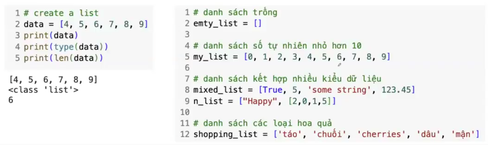
## Slicing
Truy cập theo phạm vi
### Cú pháp
```python
list[start:end:step]
```
### append() method
Dùng để thêm giá trị vào cuối danh sách
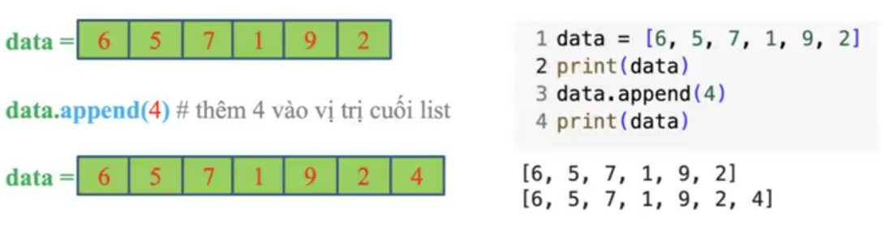
### insert() method 
Dùng để thêm giá trị vào một index cụ thể trong danh sách
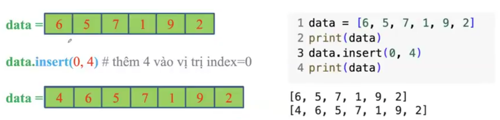
### extend() method
Dùng để mở rộng danh sách cũ bằng cách thêm danh sách mới vào cuối list cũ
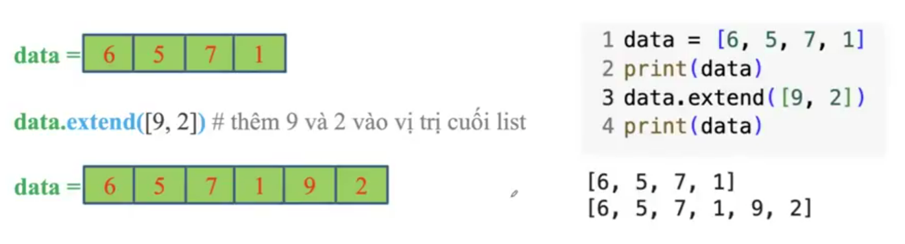
### Updating
Có thể cập nhật giá trị mới của chỉ mục thông qua toán tử =
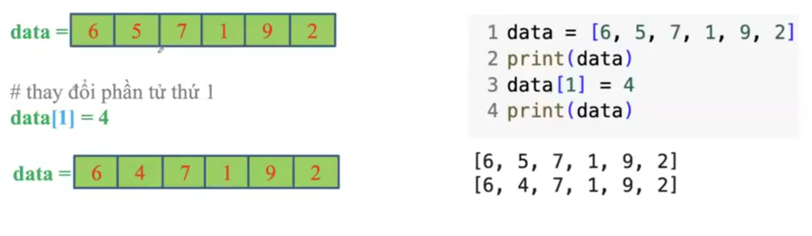
### Xóa element khỏi list
- Sử dụng remove() và pop()
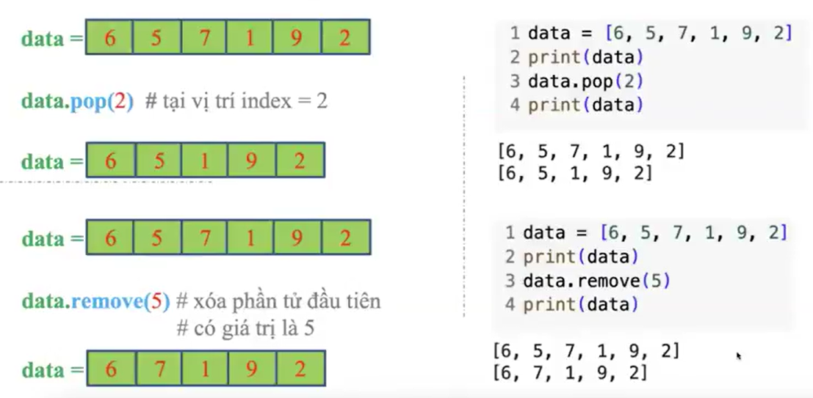
- Sử dụng từ khóa `del` để xóa đối tượng hoặc clear() để xóa tất cả thành phần, trả về danh sách rỗng
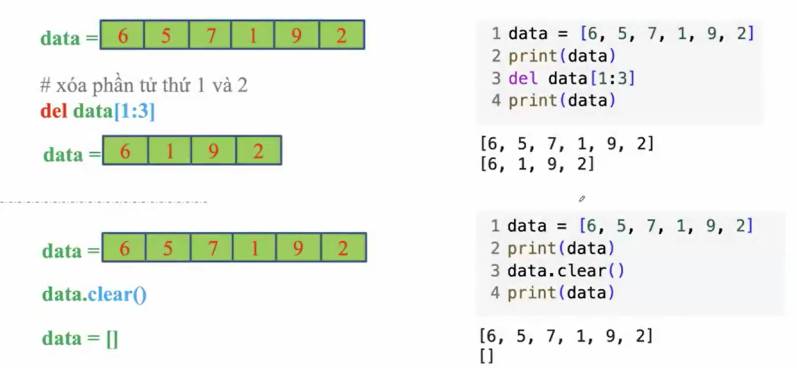
- Sử dụng index() để trả về vị trí đầu tiên có giá trị mà mình truyền vào
- reverse() dùng để đảo ngược chuỗi
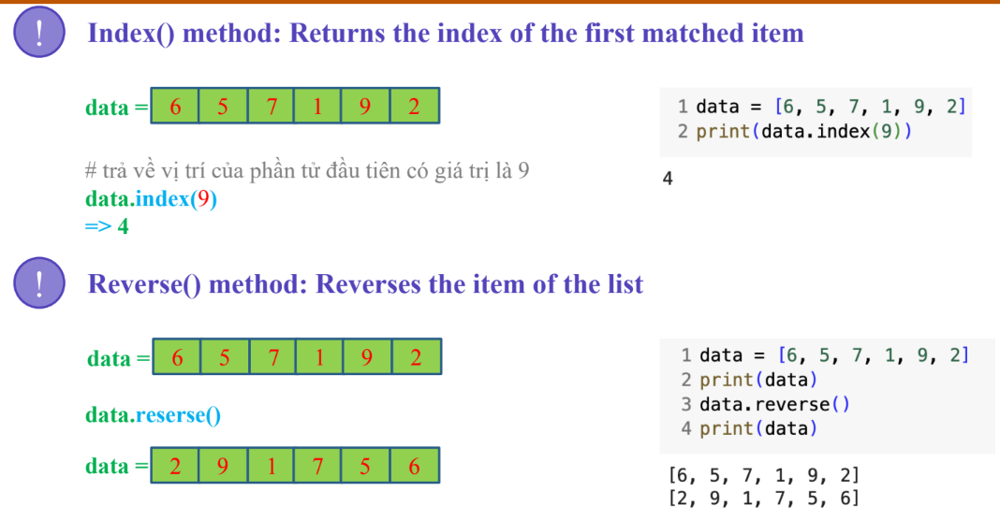
- Hàm count(): Truyền vào 1 phần tử. Hàm count sẽ đếm xem phần tử đó xuất hiện mấy lần trong danh sách.
- Hàm copy(): Dùng để sao chép các giá trị danh sách này vào trong danh sách mới.
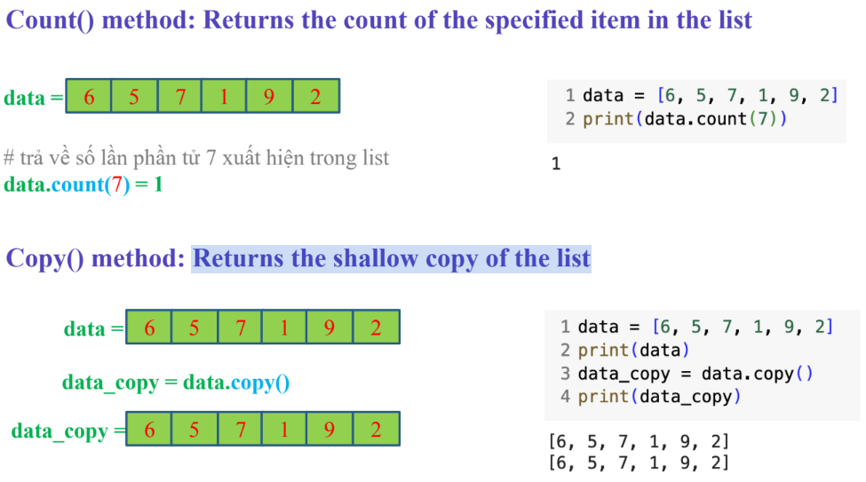
- Hàm sort(): Giúp sắp xếp giá trị trong danh sách theo tăng dần hoặc giảm dần.
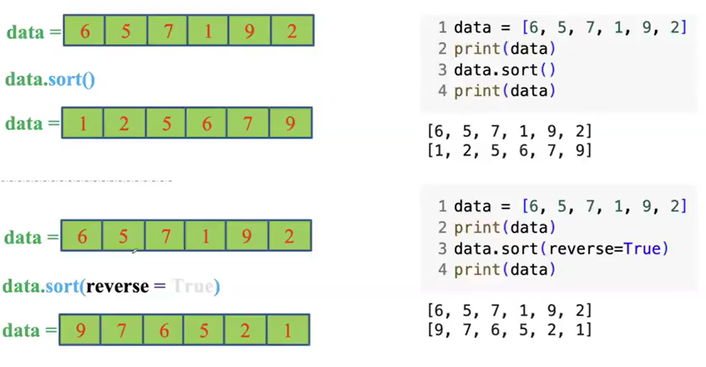
### Toán tử +,*
Phép +: Dùng để nối danh sách
Phép *: Dùng để lặp lại danh sách
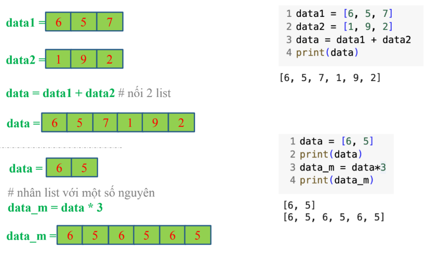
## Built-in Function for list
- Hàm len(): Trả về độ dài danh sách, có bao nhiêu phần tử ?
- Hàm min(): Trả về phần tử có giá trị nhỏ nhất trong danh sách
- Hàm max(): Trả về phần tử có giá trị lớn nhất trong danh sách
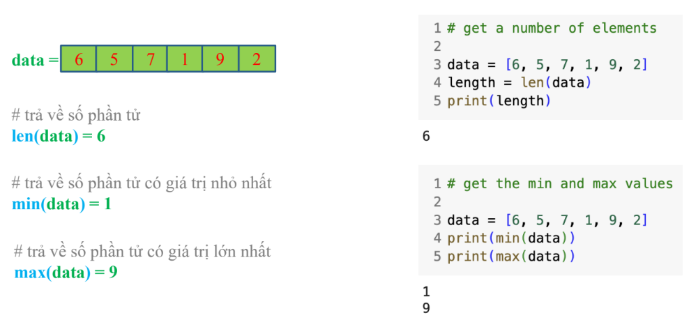
- Hàm sum(): Trả về tổng
    - Cấu trúc: `sum(iterable, start)` (sau khi tính sum của list + thêm giá trị start nếu có)
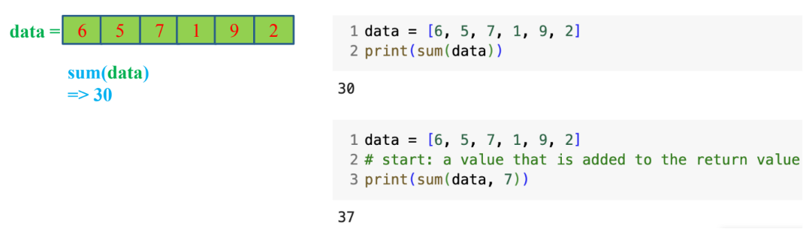
- Hàm zip(): Các danh sách ánh xạ index với nhau và trả về kết quả
    - Cấu trúc: `zip(*iterators)`
Ví dụ: list1= [1,2,3]
       list2= [4,5,6]
Trả về kết quả [list1[0], list2[0]] = 1,4
               [list1[1], list2[1]] = 2,5
               [list1[2], list2[2]] = 3,6
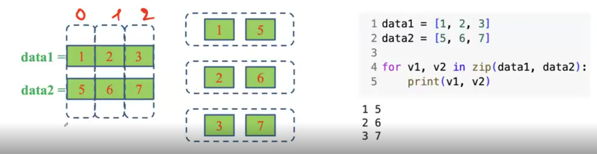
Nếu độ dài khác nhau. Nó sẽ lấy ánh xạ theo danh sách có độ dài nhỏ hơn.
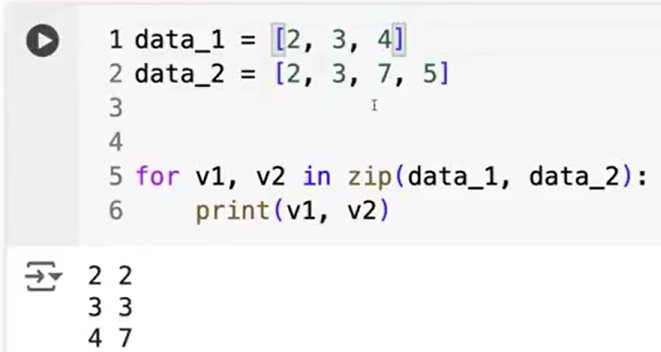
- Hàm reverse():
    - Cấu trúc `reversed(iterable)`
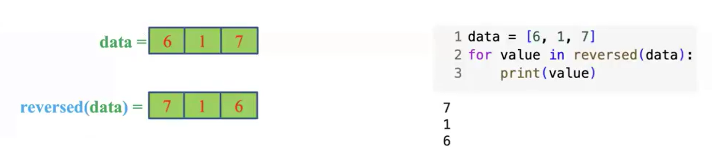
- Hàm enumerate(): Tiến hành nén các giá trị tương ứng của index với giá trị của index ấy
    - Cấu trúc: `enumerate(iterable, start)`
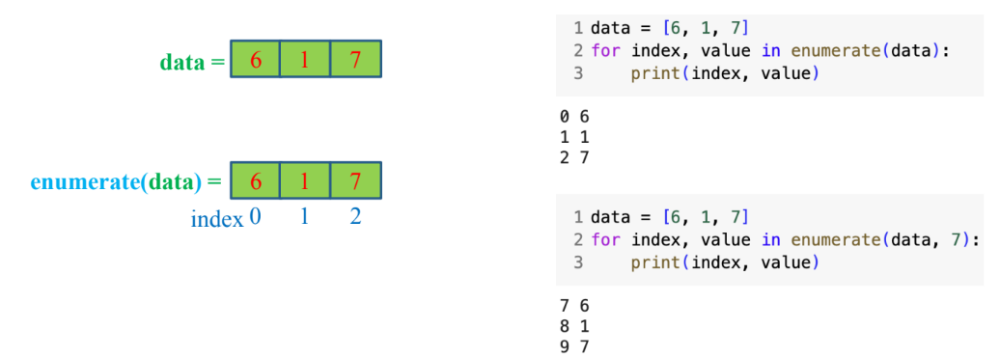